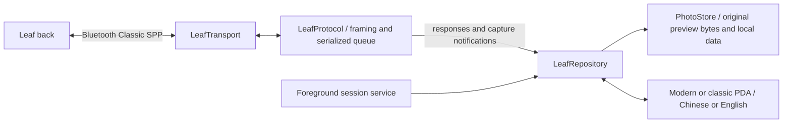

# Architecture and state retention

[简体中文](architecture.md) · [Project home](../README.en.md)

## Layers

| Layer | Responsibility |
| --- | --- |
| `LeafTransport` / `BluetoothTransport` | Bluetooth link, byte reads / writes and socket lifecycle; no image or camera-operation interpretation |
| `StreamFramer` / `LeafProtocol` | Control / attachment framing, serialized requests, response matching, notifications, timeouts and closure |
| `LeafRepository` / `PhotoStore` | Session and photo state, directories, queue, cache, integrity, local stars and notes |
| Compose interface | Two styles and languages driven by the same state, with honest capabilities |
| `LeafSessionService` | connectedDevice foreground session and notification disconnect; no fabricated reconnect success |
| Research tools | CAB, PE and ARM evidence, isolated from APK runtime |

## Session and image path

The app connects through the standard SPP UUID, then requests synchronization, time and the root directory using static evidence. Clicking a button or creating a socket does not establish readiness. With no verified transaction ID, only one request awaits a reply. Timeouts close the stream so late replies cannot contaminate another request.

Validated capture notifications enter a bounded preview queue. GetImage needs a matching filename and attachment length before decoding a preview and storing original bytes and SHA-256. Unknown binary data is not reported as a complete MOS download. Busy, unsaved or error notifications are not successful captures.

Version 0.3.1 protects whole read/write/readback operations and automatic preview transfers with the same repository operation lock; notification Ack bypasses it. Background configuration refresh preserves the last result/error. WiView and DP-67 ShootSetup dialects serialize separately; compatibility choice and preview-cache limits persist independently of pairing mode and text encoding.

## State, language and layout

The session and repository are not owned by a transient page. Selection, zoom position, cache and operations are shared across style changes, page recreation and window changes. Display language is separate from both style and protocol encoding. Manual and system-default language choices must cover UI, notifications and messages.

Actual device names, paths, user text and original metadata remain unchanged. Localizing a label must not rewrite the photo identity sent on the wire. Classic PDA must not create another connection or a separate photo repository.

The foreground service starts from visible interaction, handles permissions and disconnects, and supports notification-driven disconnect. There is no actuator for the current shutter. Repeated post-capture refreshes are not described as continuous live view.

## Cache, boundaries and validation

Original preview bytes are preserved. Display and histograms may sample for memory control, with JPEG provenance shown. Cache quotas evict older previews while keeping local stars and notes. Private data, release keys, build caches and personal SDK settings are not source resources for upload.

Protocol tests use a substituted transport for framing and timing. Android repository tests match decodable synthetic JPEG contents. UI tests cover language, style, recreation and state. Exact back, phone, firmware and system-window behavior still require physical testing; see [acceptance](implementation-status.en.md).
