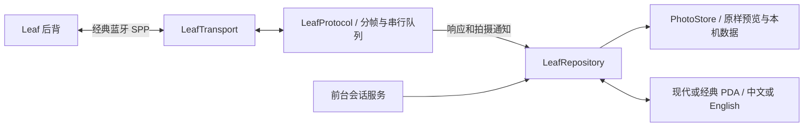

# 应用结构与状态保持

[English](architecture.en.md) · [项目首页](../README.md)

## 分层

| 层 | 主要职责 |
| --- | --- |
| `LeafTransport` / `BluetoothTransport` | 蓝牙连接、字节读取与写入、socket 生命周期；不解释图像或相机操作 |
| `StreamFramer` / `LeafProtocol` | 控制头和附件分帧、串行指令、响应匹配、通知、超时和关闭 |
| `LeafRepository` / `PhotoStore` | 连接和照片状态、目录、队列、缓存、校验、本机标记与备注 |
| Compose 界面 | 两种风格与两种语言，同一状态驱动；展示真实支持状态 |
| `LeafSessionService` | connectedDevice 前台会话与通知断开；不自动伪造连接恢复 |
| 研究工具 | 原 CAB、PE 与 ARM 静态证据；与 APK 运行隔离 |

## 会话与图像路径

应用通过标准 SPP UUID 建立连接，随后按静态依据请求同步、时间和根目录。会话就绪不根据按钮点击或 socket 创建推断。协议没有已确认的事务 ID，因此一次只等待一个请求；超时关闭链路，避免迟到回复污染下一个请求。

拍摄通知经校验后进入有界预览队列。GetImage 响应需匹配文件名与附件长度，再解码为可显示预览、保存原字节和 SHA-256。未知二进制不会当作已成功下载的 MOS 原片。busy、未保存或错误通知不会被当作成功拍摄。

v0.3.1 另在仓库层用同一操作锁保护完整的读取／写入／回读事务与自动取图；通知 Ack 不取这把锁。后台配置刷新不清空用户刚得到的确认／错误。WiView 与 DP-67 的 ShootSetup 方言分别序列化，兼容选择与预览缓存限额都持久化；配对模式和字符集仍是独立设置。

## 状态、语言与布局

会话与仓库不归某个页面的短暂生命周期所有。照片选中状态、放大位置、缓存和操作状态在风格切换、页面重建与窗口改变时共享。显示语言独立于风格，也独立于协议编码；手动选择和系统默认必须覆盖界面、通知与提示。

设备真实名称、文件路径、用户文本和原始元数据保持原样。界面文案可以本地化，不能改写在无线请求中使用的照片身份。经典 PDA 风格不能创建第二套连接或另一份照片状态。

前台服务从可见交互启动，处理权限和断线，并允许通知断开。程序不持有当前硬件不存在的快门执行器，也不把拍后通知连续刷新称为 Live View。

## 缓存、边界与验证

预览保留原字节；显示和直方图可为内存控制而采样，界面标明 JPEG 数据来源。磁盘缓存配额按最早预览回收，保留本机标记与备注。私有文件、发布私钥、构建缓存和个人 SDK 配置不上传为源码资源。

协议测试使用替代 transport 检查流与时序；Android 仓库测试检查可解码合成 JPEG 的内容对应；界面测试检查语言、风格、重建与状态。最终后背、手机、固件和系统窗口行为必须实测，见 [验收表](implementation-status.md)。
